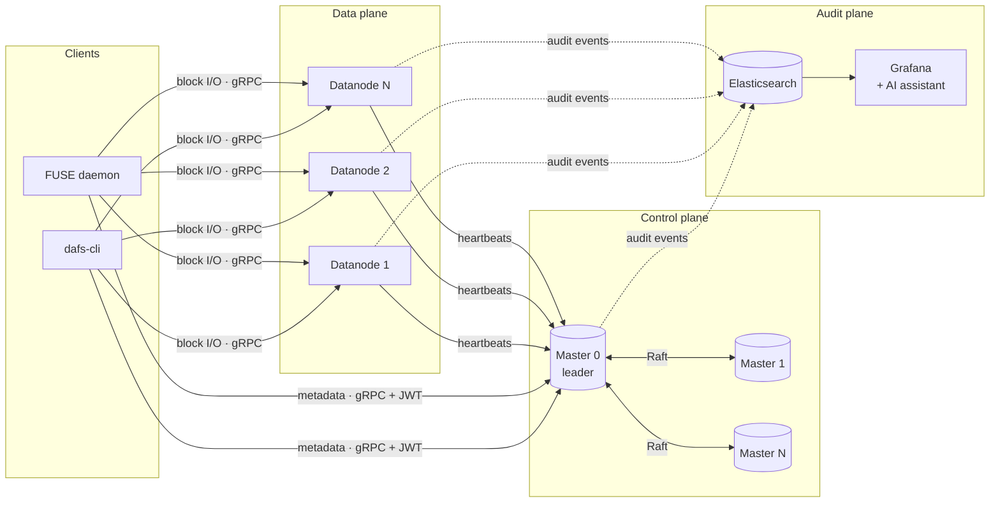
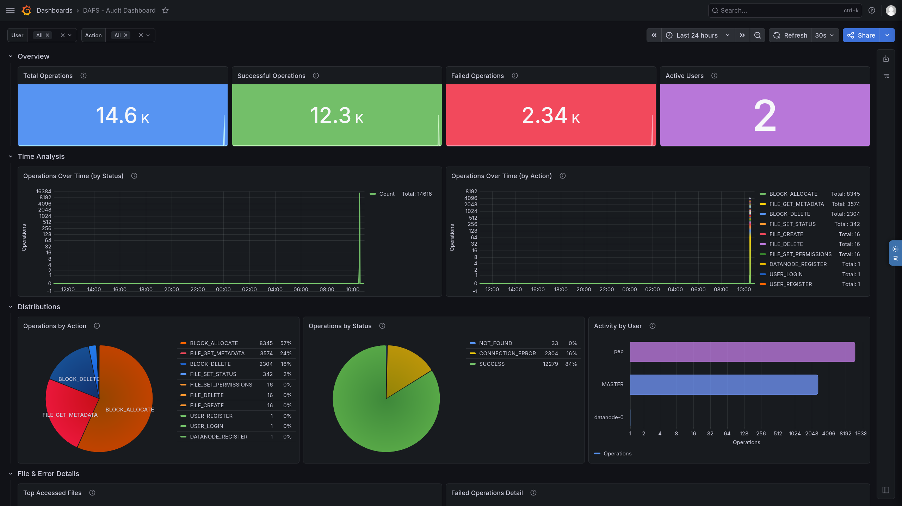
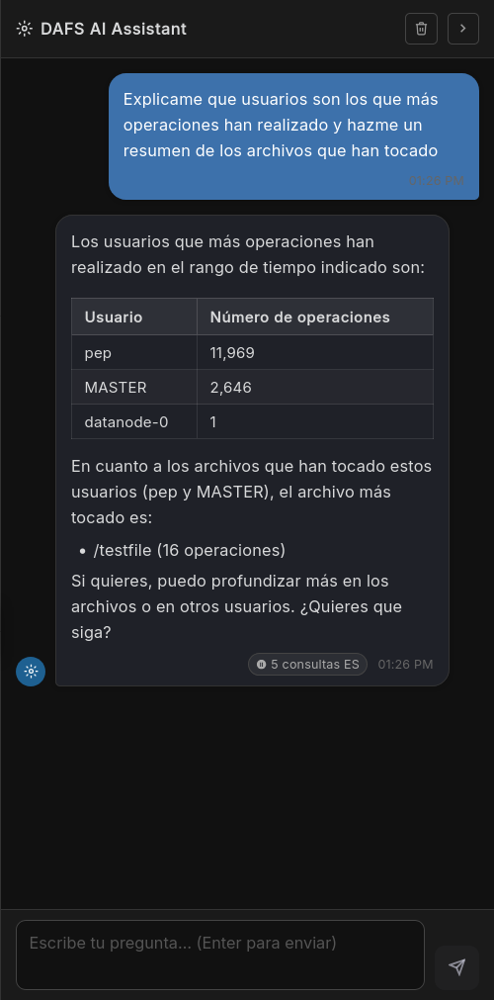
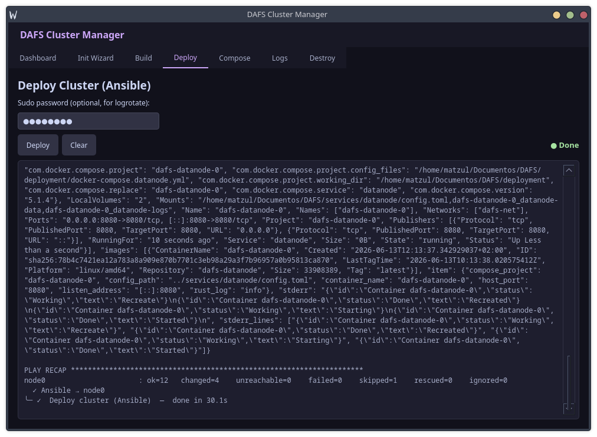

<div align="center">

# DAFS

**Distributed Audited File System**: a distributed file system written in Rust where auditing is built into the core protocol instead of being added as a separate layer.

[](https://github.com/matzull/DAFS/actions/workflows/ci.yml)


[](LICENSE)

</div>

---

In most distributed file systems, auditing is an add-on. It sits outside the data path, adds latency, and can miss operations. In DAFS every read, write, rename and delete emits an audit event as part of handling the request. The events go to Elasticsearch and can be explored in Grafana, either through a dashboard or by asking an AI assistant panel.

## Highlights

- **Audit-first design.** Audit events are emitted inside the request path, so every operation is recorded. Publishing is asynchronous, so it doesn't block the I/O.
- **Replicated metadata with Raft.** A cluster of master nodes ([OpenRaft](https://github.com/databendlabs/openraft)) keeps the namespace consistent. The namespace is an in-memory radix trie that maps files to blocks and blocks to datanodes. Membership is dynamic and leaders fail over automatically.
- **Self-registering datanodes.** Datanodes join the cluster through heartbeats and store fixed-size blocks on disk. The master re-replicates blocks when a node goes down.
- **Authentication everywhere.** Users get a JWT. Passwords are hashed with Argon2 and stored in SQLite. Masters and datanodes authenticate each other with short-lived service tokens.
- **Two ways to use it.** A command-line client (`dafs-cli`) and a FUSE daemon that mounts DAFS as a normal POSIX directory. Both are built on the same `fscore` library.
- **One-command deployments.** Docker images built with `cargo-chef`, Docker Compose stacks and an Ansible playbook. They can be driven from a CLI or a PyQt6 desktop app on one machine or many over SSH.

## Architecture



| Component | Path | What it does |
|---|---|---|
| **Master** | [`services/master`](services/master) | Metadata service. Raft consensus, the namespace (radix trie plus WAL), auth, datanode membership and block placement and re-replication. |
| **Datanode** | [`services/datanode`](services/datanode) | Stores and serves blocks, sends heartbeats to the masters and replicates blocks between nodes. |
| **Audit** | [`services/audit`](services/audit) | gRPC service that receives audit events and indexes them in Elasticsearch. |
| **Common** | [`common`](common) | Shared types, JWT helpers and the gRPC code generated from [`proto/`](proto). |
| **fscore** | [`client/fscore`](client/fscore) | Client library: leader discovery and retries, chunked upload and download, token handling. |
| **CLI** | [`client/cli`](client/cli) | `dafs-cli`: register, login, upload, download, list, rename, delete. |
| **FUSE daemon** | [`client/fuse_daemon`](client/fuse_daemon) | Mounts DAFS as a local file system. |
| **Auditing stack** | [`Auditing`](Auditing) | Elasticsearch, Grafana dashboards and the *DAFS AI Assistant* panel (FastAPI and LangChain backend). |
| **Deployment** | [`deployment`](deployment) | Dockerfiles, Compose files, the Ansible playbook and the Cluster Manager (CLI and GUI). |

## Tech stack

**Rust:** Tokio · tonic / prost (gRPC) · OpenRaft · fuser (FUSE) · jsonwebtoken · Argon2 · rusqlite · clap · figment · tracing<br/>
**Infrastructure:** Docker and Compose · Ansible · Elasticsearch · Grafana<br/>
**Tooling:** Python (PyQt6 Cluster Manager, FastAPI and LangChain assistant backend)

## Getting started

### Deploy a cluster

The Cluster Manager deploys the whole system: masters, datanodes and the auditing stack.

**Requirements:** Docker with the Compose plugin, Python ≥ 3.13, [uv](https://github.com/astral-sh/uv), and Ansible with `community.docker`.

```bash
ansible-galaxy collection install community.docker

# Desktop GUI
cd deployment/ansible/manager
uv run python main.py

# ...or the CLI
cd deployment/ansible
python cluster_manager.py init     # define the topology (hosts, masters, datanodes)
python cluster_manager.py up --build
python cluster_manager.py status
```

See [`deployment/ansible/README.md`](deployment/ansible/README.md) for multi-host (SSH) deployments and the full list of commands (`show`, `stop`, `restart`, `down`, `clean`, `destroy`).

> [!IMPORTANT]
> The sample `config.toml` files ship with a placeholder `jwt_secret` (`change-me-master-secret`). Set your own value on every master and datanode before exposing a cluster.

### Build the clients

Building the clients needs Rust (via `rustup`) and `protoc` (`protobuf-compiler`). The FUSE daemon also needs `libfuse3` / `fusermount3`.

```bash
cargo build --release -p cli
cargo build --release -p fuse_daemon
```

### Use it

```bash
dafs-cli register --username alice --password '…'
dafs-cli login    --username alice --password '…'      # stores a JWT locally

dafs-cli upload   --file ./video.mp4 --remote-path /data/video.mp4
dafs-cli list     --path /data
dafs-cli download --remote-path /data/video.mp4 --output ./video.mp4
dafs-cli rename   --old-path /data/video.mp4 --new-path /data/clip.mp4
dafs-cli delete   --file-path /data/clip.mp4
```

The clients read their settings from `config.toml` (master endpoints, chunk size, token path), and any setting can be overridden with a flag. The FUSE daemon mounts the file system at `/tmp/DAFS`.

## Screenshots

| Audit dashboard | AI assistant | Cluster Manager |
|---|---|---|
|  |  |  |

## Development

```bash
cargo fmt --all --check
cargo clippy --workspace --all-targets -- -D warnings
cargo test --workspace
```

CI ([`.github/workflows/ci.yml`](.github/workflows/ci.yml)) runs these three checks on every push and pull request. The scripts in [`testing/`](testing) contain the benchmarks and profiling tools (flamegraph, callgrind) used to evaluate the system.

```
.
├── common/            shared types + generated gRPC code
├── proto/             dfs.proto, raft.proto
├── services/          master, datanode, audit
├── client/            fscore, cli, fuse_daemon
├── Auditing/          Elasticsearch + Grafana + AI assistant
├── deployment/        Dockerfiles, Compose, Ansible, Cluster Manager
└── testing/           benchmarks and profiling scripts
```

## About

DAFS was built as my Master's thesis (Máster en Ingeniería Informática, Universidad Carlos III de Madrid).

Released under the [MIT License](LICENSE).
